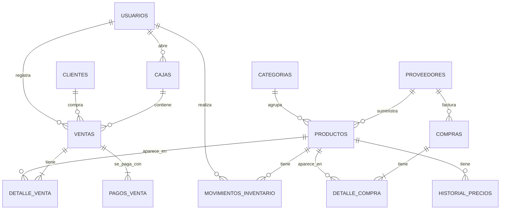

# Base de datos

Motor: **PostgreSQL 16 o superior**. El esquema vive en migraciones Flyway, no en este documento:

| Archivo | Contenido |
|---|---|
| `src/main/resources/db/migration/V1__esquema_inicial.sql` | Tablas, índices, triggers, datos iniciales |
| `src/main/resources/db/migration/V2__vista_estado_stock.sql` | Vista `v_estado_stock` (RF-30 a RF-33) |
| [`consultas-sql.md`](consultas-sql.md) | Consultas de reportes y operaciones críticas |

**Una migración ya aplicada nunca se edita.** Cualquier cambio de esquema es una migración nueva (`V3__...`, `V4__...`) y se refleja en este documento.

## Diagrama entidad-relación

## Motor de base de datos: PostgreSQL

Se usa **PostgreSQL 16 o superior** por estas razones:

- **Migraciones seguras.** En PostgreSQL el DDL es transaccional: si una migración de Flyway falla a mitad, se revierte completa y la base nunca queda a medio migrar.
- **Integridad estricta.** Rechaza cualquier dato inválido en lugar de ajustarlo en silencio, algo importante cuando se maneja dinero e inventario.
- **Reportes.** Vistas, vistas materializadas, `FILTER` y funciones de ventana permiten escribir los reportes de stock y ventas directamente en SQL.
- **Búsqueda de productos.** Con las extensiones `unaccent` y `pg_trgm`, buscar "lapiz" encuentra "Lápiz" y "cuardeno" encuentra "Cuaderno".
- **Consecutivos sin saltos.** `UPDATE ... RETURNING` permite tomar el siguiente número de venta de forma atómica.

**Decisiones de diseño del esquema:**

- Los dineros son `NUMERIC(12,0)`: exactos y en pesos enteros (RN-02).
- Los valores fijos (roles, medios de pago, tarifas de IVA) se guardan como `VARCHAR` con `CHECK` en lugar de tipos `ENUM` nativos, porque así se mapean directamente con `@Enumerated(EnumType.STRING)` de JPA y agregar un valor nuevo es una migración simple.
- Las fechas son `TIMESTAMPTZ` y la aplicación trabaja en la zona `America/Bogota`.
- PostgreSQL **no crea índices automáticamente sobre las llaves foráneas**, así que el script los crea explícitamente.
- El consecutivo de ventas **no usa una secuencia**, porque las secuencias dejan saltos cuando una transacción se revierte. Se usa la tabla `consecutivos` bloqueando la fila dentro de la transacción de la venta (RN-31).

## Vista de estado del stock

`v_estado_stock` calcula en un solo lugar el estado de cada producto (`AGOTADO`, `STOCK_BAJO`, `POR_AGOTARSE`, `NORMAL`), los días de inventario y la cantidad sugerida de compra. Lee sus parámetros de la tabla `configuracion`, por lo que cambiar un umbral no requiere tocar código. Cumple RN-25 a RN-28.

- La columna `ultima_venta` solo considera el periodo de cálculo. Para el reporte de agotados (RF-31), la última venta histórica se consulta aparte en `detalle_venta`.
- Si el catálogo crece mucho, se puede convertir en `MATERIALIZED VIEW` con `REFRESH MATERIALIZED VIEW` cada hora.

## Cambios respecto al borrador original

La primera versión del esquema se corrigió en dos puntos (ya incluidos en `V1`):

1. `ventas.descuento_autorizado_por`: registra qué administrador autorizó un descuento por encima del límite (RN-33).
2. Tabla `auditoria`: cubre RN-45 para acciones que no quedan en otra tabla (usuarios, configuración). Los cambios de precio, ajustes de inventario y anulaciones ya quedan en `historial_precios`, `movimientos_inventario` y `ventas`.

## Pendientes de modelo

Ver [08-decisiones-pendientes.md](08-decisiones-pendientes.md): conteo físico por sesiones (RF-18) y anulación con caja cerrada.
